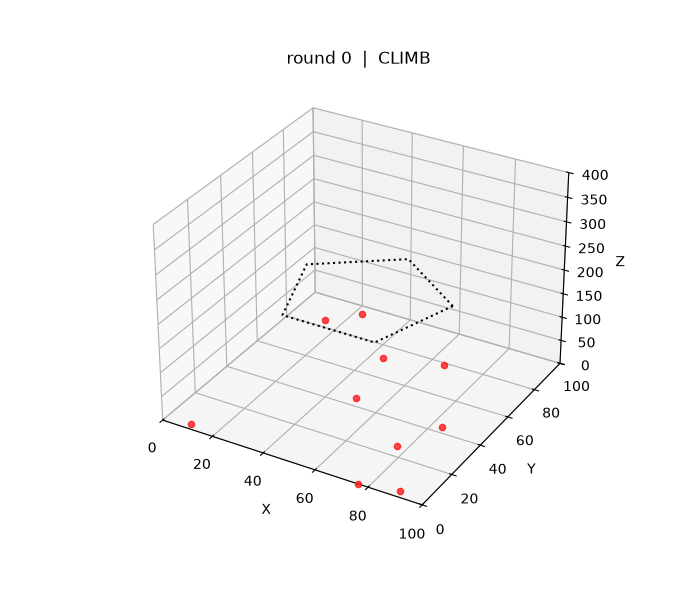
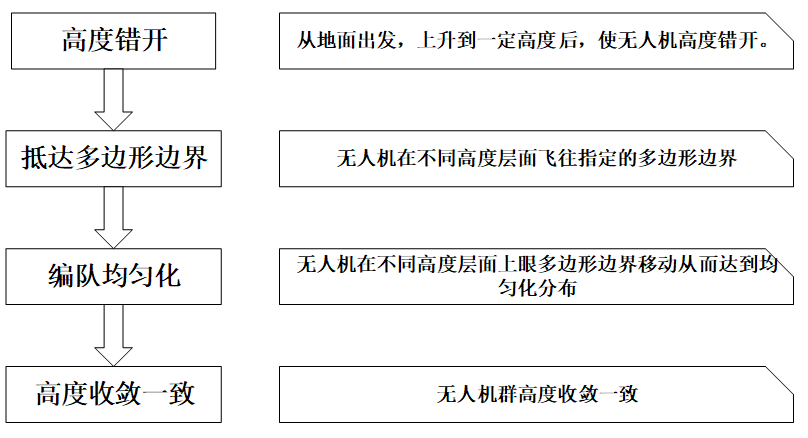

# 基于自组织的多无人机编队仿真

多架无人机没有中心控制，各自根据观察到的其他个体状态做决策，最终在指定高度排成均匀分布的正多边形编队。



## 快速开始

需要 Python ≥ 3.10。推荐用 [uv](https://docs.astral.sh/uv/)，首次运行会自动安装依赖：

```bash
uv run formation                     # 弹窗播放 3D 动画，可拖动旋转视角
uv run formation -n 16 -m 4 --seed 3 # 16 架无人机、四边形、固定随机种子
uv run formation --headless          # 不画图，只输出用了多少轮
uv run formation --save demo.gif --rounds-per-frame 2 --fps 15   # 导出 GIF
uv run python -m unittest            # 运行测试
```

不用 uv 时：

```bash
python -m venv .venv && source .venv/bin/activate
pip install -e .
formation          # 或 python -m formation
```

| 参数 | 默认值 | 说明 |
|---|---|---|
| `-n` | 10 | 无人机数量 |
| `-m` | 5 | 多边形边数 |
| `-r` | 30 | 多边形外接圆半径 |
| `--height` | 200 | 编队高度 |
| `--seed` | 随机 | 随机种子，固定后结果可复现 |
| `--headless` | — | 不画图，跑完后打印结果 |
| `--save FILE.gif` | — | 保存为 GIF，不弹窗 |
| `--rounds-per-frame` | 1 | 每帧推进的轮数，调大可加速动画 |
| `--fps` | 30 | 保存 GIF 的帧率 |

## 问题设定

1. 把无人机看成具有一定体积、可自主移动的球体，不考虑具体动力学特性。个体之间不能接触、碰撞。
2. 个体是同质、可互换、匿名的：除所处位置和运动状态外没有任何差别，也无法依靠 ID 分辨其他个体。
3. 所有个体共享同一笛卡尔坐标系，目标多边形的位置固定且已知。
4. 忽略通信细节，不考虑时延和定位误差：每个个体都能准确知道其他个体的位置，并可向其发起询问。
5. 激活是异步的：同一时刻只激活一个个体，被激活者观察环境、做出决策并移动一步。仿真中每一轮按随机顺序把所有个体各激活一次。

运动约束：个体之间保持最小间距；每次激活时的移动距离不超过上限（水平 `v_xy`，竖直 `v_z`）。

## 算法流程



整个过程分为五个阶段。个体完成当前阶段后原地等待，观察到所有个体都已完成，才进入下一阶段。因此任何时刻各个体所处的阶段至多相差 1。

### 1. 爬升

从地面竖直上升到编队高度 `h`。

### 2. 高度错开

每个个体生成一个随机数，根据它在全体随机数中的名次 `rank` 分到一个高度层：

```
layer = h + (rank - (n-1)/2) · span / n
```

此后的水平移动都在各自的高度层上进行，彼此不会相撞。

### 3. 抵达多边形

从近到远查看各顶点：

```python
for k in 按距离从近到远排列的顶点:
    owner = 已占领顶点 k 的个体
    if owner is None:
        飞向顶点 k，到达后成为它的占领者
        break
    order = owner.request_order()      # 向占领者索要排队序号
    if order is not None:
        飞向顶点 k 的第 order 个排队位置
        break
    # 该顶点的排队名额已用完，继续看下一个顶点
```

每个顶点的排队容量为 `c = ⌈(n-m)/m⌉`，保证 m 个顶点容得下 n 个个体。排队位置沿边排列，间距为 `边长/(c+1)`：奇数号排向下一个顶点，偶数号排向上一个顶点，第 `order` 号距顶点 `⌈order/2⌉` 个间距。一条边两端顶点排出的位置合计不超过 c 个，不会重叠。

### 4. 均匀化

把多边形边界参数化为弧长 `s ∈ [0, L)`，拐角处的"中点"也能直接计算。每次激活时：

```python
gap_next = 到前方最近个体的弧长
gap_pre  = 到后方最近个体的弧长
# 前后邻居的中点在 s + (gap_next - gap_pre)/2，目标取它与自身位置的中点
s += clip((gap_next - gap_pre) / 4, -v_xy, v_xy)
```

前后邻居每次重新观察，不依赖 ID，也不需要记忆。当两侧间距与理想值 `L/n` 的差都小于容差时，本阶段完成。

### 5. 高度收敛

从各自的高度层回到编队高度 `h`，编队完成。

## 项目结构

```
formation/
├── agent.py        智能体：五个阶段的决策与运动参数 Params
├── polygon.py      目标多边形：顶点、弧长参数化、排队位置
├── simulation.py   调度：生成初始位置，每轮随机顺序异步激活
├── visualize.py    matplotlib 3D 动画与 GIF 导出
└── __main__.py     命令行入口
tests/              几何、编队结果与防碰撞测试
docs/               演示 GIF 与流程图
```

测试覆盖 200 组配置（n ∈ {1, 2, 3, 5, 8, 10, 16, 25}，m ∈ {3, 4, 5, 6, 8}，各 5 个随机种子），检查编队能完成、最终高度一致、所有个体都在边界上且均匀分布，以及全过程任意两机距离始终大于 1。

最初的单文件实现在 git 历史中（提交 `b80b151` 的 `Done/plgsim.py`）。

## 相关链接

1. 博客：https://blog.csdn.net/py431382/article/details/89854176
2. 视频：https://www.bilibili.com/video/BV1PE41117m6

## 另：基于自组织的多智能体追逐与合围

视频：https://www.bilibili.com/video/BV1PE41117DG

代码待整理上传。
